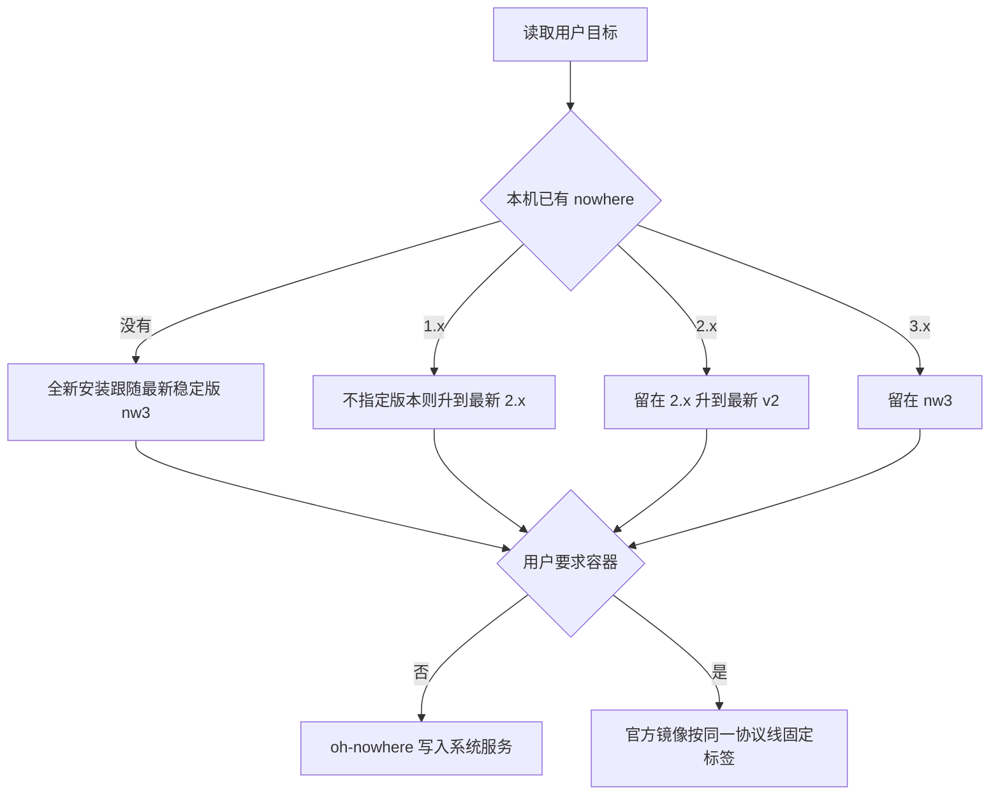

# Agent 部署指南

这份文档给要在目标机上装好 Nowhere 的 Agent。参数全集、URL 形态和证书细节在 [README_zh_CN.md](../README_zh_CN.md)。这里只保留决策、可执行命令、停止条件和验收。

`oh-nowhere` 在宿主机上安装二进制并写入系统服务。Docker 使用上游镜像，脚本不创建、不升级容器。目标机不编译 Nowhere。

只使用带明确参数的命令，并把标准输入重定向到 `/dev/null`。终端里即使已经传入 `--key`，openssl、自定义证书和 acme 仍会询问证书细节；重定向之后脚本直接采用命令行上的值。不要打开菜单。

## 决策



先确定三件事，再执行：

| 问题 | 取值 |
| ---- | ---- |
| 角色 | 公网入口用 `portal`；本机 SOCKS 客户端用 `vector`；无入站端口的远端出口用 `egress`（仅 nw3） |
| 协议线 | 见下一节。已安装节点留在当前主版本，除非用户明确要求跨线 |
| 运行方式 | 默认宿主机服务。用户要求容器，或这台机器已经用 Docker 跑服务时，走文末 Docker |

用户没指定角色时：这台机器是服务器，装 `portal`。用户要连已有 Portal，或这台机器只做本机代理时，装 `vector`。用户要给 `out=egress` 的 Portal 提供出口时，装 `egress`。

同一台机器的宿主机安装只有一份 `/etc/nowhere/url.conf`、一个 `nowhere` 服务。Docker 则一个容器一种角色。两种方式不要占用同一组端口。

### 停止条件

出现下面任一情况就停，把原因交回用户，不要换一条协议线重试：

* 系统不是 Debian、Ubuntu、Alpine 或 FreeBSD，或架构不是 `x86_64` / `aarch64`
* FreeBSD 上目标版本低于 2.0
* 端口已被占用，且用户没有指定另一个端口
* 已安装节点要跨 nw2 与 nw3，但用户没有明确要求
* 迁往 nw3 时 `url.conf` 含 `next=`
* 迁回 nw2 时角色是 Egress，或 Portal 使用 `out=egress`
* 二进制下载或启动失败
* 宿主机服务已经占用目标端口，又要在同端口起容器

## 版本区别

Portal 与客户端必须处于同一协议线。部署前用下面的接口看最新 tag，不要把表格里的「当前」当成永久事实。

```bash
curl -fsSL https://api.github.com/repos/NodePassProject/Nowhere/releases/latest
```

`tag_name` 是全新安装要跟的稳定版。2026-10-15 核对时为 `v3.0.0`。2.x 停留线是脚本常量 `NW2_LTS_VERSION=v2.2.1`：最近 30 个 release 里没有 `v2.*` 时用它。1.x 的终点标签是 `v1.8.3`。

| 协议线 | 代表标签 | 线协议 | 与相邻线 | Agent 要记住的差异 |
| ------ | -------- | ------ | -------- | ------------------ |
| 1.x | `v1.8.3` | 1.5 起更换；ALPN 默认 `now/1` | 与 2.x 不通 | 载体写 `net=`。1.6 起有只读 TUI。1.7 起有 `next=`。1.8 用 `mux` 取代 `pool`。无 FreeBSD 包，无 `morph`。密钥可以是任意非空字符串 |
| 2.0 | `v2.0.1` 起含 FreeBSD | ALPN 固定 `nw2` | 与 1.x、nw3 都不通 | 载体改到端点路径，可拆分 TCP/UDP，支持 `morph`。`v2.0.0` 没有 FreeBSD 包 |
| 2.2 | `v2.2.1` | 仍是 `nw2` | 对已有 2.x 节点，密钥和证书校验是运行时破坏性变更 | `v2.2.0` 的 Portal 密钥恰好 64 位小写十六进制；`v2.2.1` 放宽为 32–64 位。默认校验证书，自签客户端需要 `pin=`。这是 2.x 停留线 |
| 3.0 / nw3 | `v3.0.0` | ALPN `nw3` | 与 nw2 不通 | 三种角色的密钥恰好 32 位小写十六进制。Portal 出口是 `out=direct`、`out=<socks 端点>` 或 `out=egress`。Vector 用 `in=`，且只有一个载体。新增 Egress。没有 `next=`。`morph` 默认 `1` 并写入 URL。`tls` 只接受 `1` 或 `2`。状态命令是 `nowhere status` |

不带 `--version` 时，脚本的目标是：

* 未安装，或已安装 nw3：最新稳定版
* 已安装 2.x：最新 `v2.*`，没有则 `v2.2.1`
* 已安装 1.x：同样指向最新 `v2.*`，不会留在 1.x

留在 1.x 必须显式 `--version v1.8.3`。跨 nw2 与 nw3 还要 `--allow-protocol-breaking-upgrade`。显式 `--version` 不会跳过这道确认。

## 下载链接

脚本：

```text
https://raw.githubusercontent.com/ohmycggk/oh-nowhere/main/oh-nowhere.sh
```

发布页与接口：

```text
https://github.com/NodePassProject/Nowhere/releases
https://github.com/NodePassProject/Nowhere/releases/latest
https://api.github.com/repos/NodePassProject/Nowhere/releases/latest
https://github.com/NodePassProject/Nowhere/releases/download/<tag>/<asset>
```

资产名：

| 系统 | 文件名 |
| ---- | ------ |
| Linux | `nowhere-<arch>-unknown-linux-<libc>.tar.gz` |
| FreeBSD（2.0.1+） | `nowhere-<arch>-unknown-freebsd.tar.gz` |
| macOS | `nowhere-aarch64-apple-darwin.tar.gz` |
| Windows | `nowhere-x86_64-pc-windows-msvc.zip` |

`<arch>` 为 `x86_64` 或 `aarch64`。Linux 的 `<libc>` 为 `gnu` 或 `musl`。macOS 与 Windows 包由上游发布，`oh-nowhere` 不安装它们。

GNU 构建需要 glibc 2.39（Ubuntu 24.04 / Debian 13）。更旧的 glibc 由脚本改下 musl。Agent 不要自己挑错资产；宿主机安装把版本交给 `--version`，libc 交给脚本。

Docker 镜像：

```text
ghcr.io/nodepassproject/nowhere:<tag>
```

2026-10-15 核对到的标签：`latest`，以及 `v1.8.0`、`v1.8.1`、`v1.8.2`、`v1.8.3`、`v2.0.0`、`v2.0.1`、`v2.0.2`、`v2.1.0`、`v2.1.1`、`v2.1.2`、`v2.2.0`、`v2.2.1`、`v3.0.0`。`v1.8.0` 之前没有镜像。生产环境使用带 `v` 的协议线标签，例如 `v3.0.0` 或 `v2.2.1`。`latest` 当时指向 `v3.0.0`，不作为生产标签。镜像是多架构 `linux/amd64` 与 `linux/arm64`，对应宿主机的 `x86_64` 与 `aarch64`。

## 宿主机部署

### 部署前检查

```bash
uname -s
uname -m
command -v nowhere && nowhere --version
ss -H -tuln | awk '{print $5}' | grep -E '[:.]2077$' || true
```

需要 root。已有 `nowhere` 时先读出版本，按上一节留在当前协议线。`2077` 已被占用时，向用户要一个空闲端口再继续；默认端口是 `2077`。

nw3 密钥用 32 位小写十六进制。本机还没有 `nowhere` 时：

```bash
KEY=$(openssl rand -hex 16)
printf '%s\n' "$KEY"
```

没有 `openssl` 时：

```bash
KEY=$(od -An -N16 -tx1 /dev/urandom | tr -d ' \n')
```

二进制已经安装时，优先 `nowhere generate-key`。Portal、Vector、Egress 使用同一把密钥。密钥只交给用户和对端，不写进仓库。

### 安装

```bash
curl -fsSL https://raw.githubusercontent.com/ohmycggk/oh-nowhere/main/oh-nowhere.sh -o oh-nowhere.sh
chmod +x oh-nowhere.sh
```

长期公开的 Portal 使用 openssl 自签。`pin` 跨重启保持不变。把 `relay.example` 换成分享主机名或用户指定的地址：

```bash
sudo ./oh-nowhere.sh \
  --install \
  --lang zh \
  --type portal \
  --key "$KEY" \
  --port 2077 \
  --cert-mode openssl \
  --self-sign-days 398 \
  --host relay.example \
  < /dev/null
```

短期验证可以用默认的程序自签。它每次重启都换证书，`pin` 跟着变，验收时要把这件事告诉用户：

```bash
sudo ./oh-nowhere.sh --install --lang zh --type portal --key "$KEY" --port 2077 < /dev/null
```

已有解析到本机的公网域名、且用户要求公共 CA 证书时，按 README 的「acme.sh 证书」使用 `--cert-mode acme`。80 端口必须空闲，除非用户已改用 DNS 验证。

Vector。`--host` 必须是 Portal 的具体主机，不能是 `*`：

```bash
sudo ./oh-nowhere.sh \
  --install \
  --lang zh \
  --type vector \
  --key "$KEY" \
  --host relay.example \
  --port 2077 \
  --net tcp \
  --socks 127.0.0.1:1080 \
  < /dev/null
```

自签 Portal 还要带上从 Portal 侧拿到的 `--pin <64位小写十六进制>`。

Egress。它向 `out=egress` 的 Portal 发起出站 QUIC，不需要入站端口：

```bash
sudo ./oh-nowhere.sh \
  --install \
  --lang zh \
  --type egress \
  --key "$KEY" \
  --host relay.example \
  --udp-port 2077 \
  < /dev/null
```

自签 Portal 同样带上 `--pin`。

指定旧协议线时加上版本，例如 `--version v2.2.1` 或 `--version v1.8.3`。Egress 不能加在 2.x 或 1.x 上。

本机已经装有 Nowhere 时，`--install` 转入升级，不会按上面的参数重写配置。改配置用：

```bash
sudo ./oh-nowhere.sh --config --lang zh --type portal --key "$KEY" --port 2077 --cert-mode openssl --host relay.example < /dev/null
```

### 升级

留在当前协议线：

```bash
sudo ./oh-nowhere.sh --upgrade --lang zh < /dev/null
```

用户明确要求跨到 nw3，且预检没有 `next=`：

```bash
sudo ./oh-nowhere.sh --upgrade --allow-protocol-breaking-upgrade --lang zh < /dev/null
```

用户明确要求回到 2.x，且当前不是 Egress、Portal 也不是 `out=egress`：

```bash
sudo ./oh-nowhere.sh --upgrade --version v2.2.1 --allow-protocol-breaking-upgrade --lang zh < /dev/null
```

脚本会把 `url.conf` 备份为 `url.conf.nw<旧主版本>.bak.<时间戳>`，二进制备份为 `nowhere.bak.<时间戳>`。跨线之后重新执行 `--share`，把新的分享 URI 交给用户。

### 防火墙

只放行实际监听的载体。默认同端口 `mix` 要同时放行 TCP 与 UDP。仅 TCP 或仅 UDP 时只放行对应协议。Vector 的 `127.0.0.1:1080` 和 Egress 不需要公网入站规则。

防火墙若已启用，在原有策略上追加端口，不要关闭防火墙。例如 UFW：

```bash
sudo ufw allow 2077/tcp
sudo ufw allow 2077/udp
```

firewalld：

```bash
sudo firewall-cmd --permanent --add-port=2077/tcp
sudo firewall-cmd --permanent --add-port=2077/udp
sudo firewall-cmd --reload
```

### 验收

```bash
nowhere --version
sudo ./oh-nowhere.sh --status --lang zh
sudo ./oh-nowhere.sh --share --lang zh
ss -H -tuln | grep -E '[:.]2077$' || true
```

服务应处于运行中。Portal 的 `--share` 给出 `nowhere://` 分享 URI。把分享 URI 交给用户。运行 URL（`portal://`、`vector://`、`egress://`）留在 `/etc/nowhere/url.conf`，不要当作客户端链接公开。

按初始化系统复查：

```bash
sudo systemctl status nowhere
sudo journalctl -u nowhere -n 50 --no-pager
```

Alpine 用 `rc-service nowhere status`。FreeBSD 用 `service nowhere status`。启动失败时把这段日志交回用户并停止。

openssl 自签验收时，`--status` 应能看到证书来源和 pin 前缀。程序自签则说明：重启后 pin 会变，需要重新发送分享 URI。

交回用户的结果包括：版本、角色、协议线、监听端口、服务状态、Portal 分享 URI。Vector 与 Egress 没有客户端导入链接，改为交回运行 URL 里的主机、端口和入口地址，密钥另行送达。

## Docker 部署

在用户要求容器，或目标机已经用 Docker 提供服务时使用。镜像由上游在 tag `v*.*.*` 时构建并推到 GHCR。运行时基于 `scratch`：入口是 `/nowhere`，带 CA 证书包，没有 shell、包管理器和动态库。glibc 版本不影响这张镜像。

生产标签固定在协议线上，例如 `ghcr.io/nodepassproject/nowhere:v3.0.0`。一个容器一种角色。URL 作为容器参数。密钥不写进镜像，compose 文件不提交真实密钥。

发布的端口必须和端点载体一致。`*:2077` 同时发布 TCP 与 UDP。只发布一种协议时，另一个载体不可达。`tls=2` 时只读挂载 PEM。状态查询需要可写 `/tmp`。使用非 root、只读根文件系统和 `tmpfs /tmp`。重启策略用 `unless-stopped`。

状态命令：

```bash
docker exec --user 10001:10001 nowhere-portal /nowhere status
```

镜像里没有 `curl` 或 `wget`，健康检查不要调用它们。`/nowhere status` 只说明进程能回答本地状态，不能代替端口和对端连通性检查。

宿主机上的 `oh-nowhere` 已经占用同端口时，先停掉那一个服务，或改端口。不要并行监听。

升级只在同一协议线内更换标签，然后 `docker compose pull` 与 `docker compose up -d`。更换主版本视为跨线：先停容器、备份 compose，用户确认后再改 URL 语法。nw3 与 nw2 的 URL 差异见上面的版本表和 README「升级与跨线」。

QUIC 经 Docker 端口转发不稳定时，才把该容器改为 `network_mode: host`。改用 host 网络后删除 `ports`。Vector 默认就用 host 网络，这样 `in=127.0.0.1:1080` 落在宿主机回环上，而不是容器网络里。

下面三份是 nw3 的最小 compose。把占位符换成生成的密钥、主机名和证书路径。Portal 与 Egress、Vector 使用同一把 32 位密钥。

### Portal

在宿主机生成证书再挂进容器。容器内路径用 `/cert.pem` 与 `/key.pem`。私钥要让 UID `10001` 可读：

```bash
sudo install -d -m 0755 /etc/nowhere
sudo openssl req -x509 -newkey ec -pkeyopt ec_paramgen_curve:prime256v1 \
  -keyout /etc/nowhere/key.pem -out /etc/nowhere/cert.pem \
  -days 398 -nodes \
  -subj "/CN=relay.example" \
  -addext "subjectAltName=DNS:relay.example"
sudo chown 10001:10001 /etc/nowhere/key.pem /etc/nowhere/cert.pem
sudo chmod 640 /etc/nowhere/key.pem
sudo chmod 644 /etc/nowhere/cert.pem
```

`relay.example` 与分享主机一致。然后：

```yaml
services:
  portal:
    image: ghcr.io/nodepassproject/nowhere:v3.0.0
    container_name: nowhere-portal
    restart: unless-stopped
    read_only: true
    user: "10001:10001"
    cap_drop:
      - ALL
    security_opt:
      - no-new-privileges:true
    tmpfs:
      - /tmp:rw,noexec,nosuid,nodev,size=16m,mode=1777
    ports:
      - "2077:2077/tcp"
      - "2077:2077/udp"
    volumes:
      - /etc/nowhere/cert.pem:/cert.pem:ro
      - /etc/nowhere/key.pem:/key.pem:ro
    command:
      - "portal://<32位小写十六进制>@*:2077?tls=2&crt=/cert.pem&key=/key.pem&out=direct&morph=1"
    logging:
      driver: json-file
      options:
        max-size: "10m"
        max-file: "3"
```

防火墙放行 TCP `2077` 与 UDP `2077`。自签证书的客户端需要 `pin`。指纹在容器日志的启动输出里，或由对端执行 `nowhere fingerprint` 后经可信渠道核对。程序自签可以去掉 `tls`、`crt`、`key`，URL 收成 `portal://<密钥>@*:2077?out=direct&morph=1`；这种证书每次进程重启都会变。

拆分载体时改端点和端口，例如 `*/tcp:2006/udp:2017` 对应 `2006/tcp` 与 `2017/udp`。只发布其中一个协议，另一个载体不可达。

### Vector

```yaml
services:
  vector:
    image: ghcr.io/nodepassproject/nowhere:v3.0.0
    container_name: nowhere-vector
    restart: unless-stopped
    read_only: true
    user: "10001:10001"
    network_mode: host
    cap_drop:
      - ALL
    security_opt:
      - no-new-privileges:true
    tmpfs:
      - /tmp:rw,noexec,nosuid,nodev,size=16m,mode=1777
    command:
      - "vector://<32位小写十六进制>@relay.example/tcp:2077?in=127.0.0.1:1080&morph=1&pin=<64位小写十六进制>"
    logging:
      driver: json-file
      options:
        max-size: "10m"
        max-file: "3"
```

应用连接宿主机的 `127.0.0.1:1080`。不要把这个端口发布到公网。Portal 使用公共 CA 且主机名匹配时，可以去掉 `pin`。

### Egress

```yaml
services:
  egress:
    image: ghcr.io/nodepassproject/nowhere:v3.0.0
    container_name: nowhere-egress
    restart: unless-stopped
    read_only: true
    user: "10001:10001"
    cap_drop:
      - ALL
    security_opt:
      - no-new-privileges:true
    tmpfs:
      - /tmp:rw,noexec,nosuid,nodev,size=16m,mode=1777
    command:
      - "egress://<32位小写十六进制>@relay.example/udp:2077?morph=1&pin=<64位小写十六进制>"
    logging:
      driver: json-file
      options:
        max-size: "10m"
        max-file: "3"
```

不写 `ports`。Portal 必须是 `out=egress`，并且监听 UDP。公共 CA 且主机名匹配时可以去掉 `pin`。

启动：

```bash
docker compose up -d
docker compose ps
docker exec --user 10001:10001 nowhere-portal /nowhere status
docker logs --tail 50 nowhere-portal
```

验收：容器状态为 running，`/nowhere status` 能看到对应角色，宿主机 `ss` 能看到 Portal 发布的 TCP 与 UDP。没有第二台机器时，说明公网连通性尚未从外部验证。
